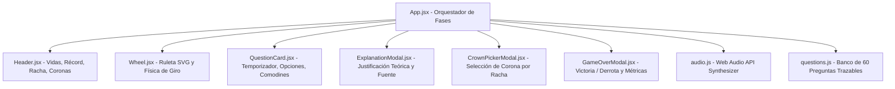

# MongoPreguntados 🍃

> **Juego interactivo de preguntas y respuestas estilo _Preguntados_ (_Trivia Crack_) sobre teoría y práctica de MongoDB & Mongoose.**  
> Proyecto desarrollado para la **Clase 16** del programa **Full Stack Developer – ITBA**.

---

## 👥 Integrantes del Equipo

- **Evelyn Arielle Noya Fraga**
- **Santino Marchesini**
- **Ángela Lucero Álvarez**
- **Julián Muiños**

---

## 📌 ¿Qué es el Proyecto?

**MongoPreguntados** es una Single Page Application (SPA) interactiva diseñada para reforzar y evaluar conocimientos sobre el ecosistema NoSQL de **MongoDB (v9.0)** y el ODM **Mongoose (v9.x) para Node.js**, tomando como fuente única de verdad la guía teórica oficial del curso.

### 🎮 Características y Mecánicas del Juego:

- **Ruleta SVG Interactiva**: 6 sectores temáticos con animación física de desaceleración y sonido sintetizado.
- **Banco de 60 Preguntas Trazables**: Cada pregunta cuenta con justificación teórica detallada y cita de sección (`source`, ej. `§9 CRUD`) del documento fuente.
- **Modo Desafío de Corona**: Al acumular una racha de **3 aciertos consecutivos**, el jugador desbloquea la oportunidad de competir por una de las 6 coronas temáticas.
- **Temporizador Dinámico de 20s**: Con cálculo por deltas de tiempo (`Date.now()`) para evitar desfasajes en pestañas inactivas y alertas visuales/sonoras en los últimos 5 segundos.
- **3 Comodines Estratégicos**: _50/50_ (descarta 2 opciones incorrectas), _+15s_ (tiempo adicional) y _Pasar_ (salta la pregunta sin penalización).
- **Retroalimentación Pedagógica Inmediata**: Explica el porqué de la respuesta correcta y muestra ejemplos de sintaxis MQL/Mongoose.
- **Pantalla de Estadísticas Finales**: Desglose de efectividad global y por categoría, guardado de nuevo récord y recomendaciones de estudio señalando la sección del PDF a repasar.

---

## 🚀 Instalación y Ejecución de Servidores

### Prerrequisitos

- **Node.js** (versión 18 o superior recomendada).
- **npm** (incluido con Node.js).

### 1. Clonar el repositorio e instalar dependencias

```bash
# Entrar al directorio del proyecto
cd mongodb-preguntados

# Instalar todas las dependencias
npm install
```

---

### 2. Ejecución de los Servidores

El proyecto contempla dos entornos de ejecución locales según la necesidad:

#### A. Servidor de Desarrollo (Development Server)

Inicia **Vite Dev Server** con recarga rápida de módulos en caliente (_Hot Module Replacement - HMR_), ideal para desarrollo y pruebas en vivo:

```bash
npm run dev
```

> 🌐 El servidor iniciará por defecto en: **`http://localhost:5173/`**

#### B. Servidor de Producción / Previsualización (Preview Server)

Compila y optimiza el bundle final para producción en la carpeta `dist/` (minificación JS/CSS y tree-shaking) y levanta el servidor local de prueba de producción:

```bash
# 1. Compilar el paquete de producción
npm run build

# 2. Iniciar el servidor local de previsualización
npm run preview
```

> 🌐 El servidor de previsualización iniciará por defecto en: **`http://localhost:4173/`**

---

### 3. Comandos de Calidad y Validación Adicionales

- **Validar calidad de código con el Linter:**
  ```bash
  npm run lint
  ```
- **Validar integridad del banco de preguntas (esquema, 4 opciones, balance y fuentes):**
  ```bash
  node scripts/validate-questions.mjs src/data/questions.js
  ```

---

## 🏛️ Arquitectura del Sistema y Decisiones Técnicas

El diseño técnico del proyecto se guio por las especificaciones de [`spec.md`](./spec.md) y [`AGENTS.md`](./AGENTS.md), priorizando una experiencia de usuario fluida, portabilidad y alta calidad estética (_Rich Aesthetics_).



### 1. Arquitectura 100% Frontend (SPA sin dependencias de backend)

- **Decisión**: La aplicación se concibió como un cliente autónomo en React sin backend, alojando la lógica del juego, puntuación y banco de preguntas en el cliente.
- **Razón**: Permite una ejecución inmediata, portabilidad total para evaluación y despliegue estático (GitHub Pages, Vercel, Netlify) sin costos de infraestructura ni dependencias de conexión a bases de datos remotas.

### 2. Core Tecnológico: React 19 + Vite + Tailwind CSS v4

- **React 19**: Aprovecha la arquitectura basada en componentes funcionales y hooks para un desacoplamiento limpio de la lógica del estado (`useState`, `useCallback`, `useRef`, `useEffect`).
- **Vite 8**: Servidor de desarrollo ultrarrápido impulsado por ES Modules nativos y compilación de producción optimizada con Rollup en menos de 300 ms.
- **Tailwind CSS v4**: Integrado mediante el plugin oficial `@tailwindcss/vite`, adoptando la nueva directiva `@import "tailwindcss";` y prescindiendo de archivos de configuración externos como `tailwind.config.js`.

### 3. Sintetizador de Sonido Nativo con Web Audio API

- **Decisión**: Los efectos de sonido (giro de ruleta, aciertos con arpegio mayor, errores, fanfarria de coronas y alerta de tiempo) se generan algorítmicamente mediante la **Web Audio API** nativa en [`src/utils/audio.js`](./src/utils/audio.js).
- **Razón**: Elimina la necesidad de descargar archivos multimedia externos (`.mp3`/`.wav`), garantiza cero latencia de reproducción, funcionamiento offline y respeta la preferencia de sonido del usuario almacenada en `localStorage`. Por defecto inicia silenciado para no interrumpir entornos de clase.

### 4. Animación Vectorial de Ruleta en SVG con Física Realista

- **Decisión**: La ruleta está construida íntegramente con primitivas SVG (`<path>`, `<g>`, `<circle>`) calculadas trigonométricamente y rotadas mediante transformaciones CSS con una curva `cubic-bezier(0.12, 0.8, 0.15, 1)`.
- **Razón**: Otorga nitidez visual absoluta en cualquier resolución (pantallas Retina o 4K), evita artefactos de imagen y permite el cálculo exacto del sector ganador alineado con el puntero superior.

### 5. Resiliencia en Temporización y Persistencia (Casos Límite)

- **Temporizador con deltas reales**: El contador de 20 segundos utiliza marcas de tiempo (`Date.now()`) en lugar de `setInterval` ingenuo, evitando que el tiempo se desincronice o se pause si el usuario cambia de pestaña.
- **Almacenamiento tolerante a fallos**: Los accesos a `localStorage` (récord de puntuación y sonido) están envueltos en bloques de manejo de excepciones para garantizar que el juego funcione sin errores incluso en modo incógnito estricto o entornos con almacenamiento local deshabilitado.

### 6. Banco de Preguntas Estructurado y Justificado

- El banco de 60 preguntas se divide equitativamente en 6 categorías correspondientes al mapa temático del documento:
  1. 🟢 **Fundamentos** (§1–4)
  2. 🔵 **Node.js y Mongoose** (§5–9)
  3. 🟣 **Diseño y consultas** (§10–14)
  4. 🟠 **Funciones especiales** (§15–18)
  5. 🔴 **Producción** (§19–21)
  6. 🟡 **Herramientas y extras** (§22–23)
- No se admiten preguntas sin referencia explícita (`source`), asegurando un valor pedagógico directo frente al material de estudio.

---

## ⌨️ Atajos de Teclado Disponibles

|                         Tecla                          | Acción                                              |
| :----------------------------------------------------: | :-------------------------------------------------- |
|                   <kbd>Espacio</kbd>                   | Girar la ruleta en la pantalla principal.           |
| <kbd>1</kbd>, <kbd>2</kbd>, <kbd>3</kbd>, <kbd>4</kbd> | Seleccionar la opción de respuesta correspondiente. |
|                    <kbd>Enter</kbd>                    | Continuar tras la retroalimentación de la pregunta. |
